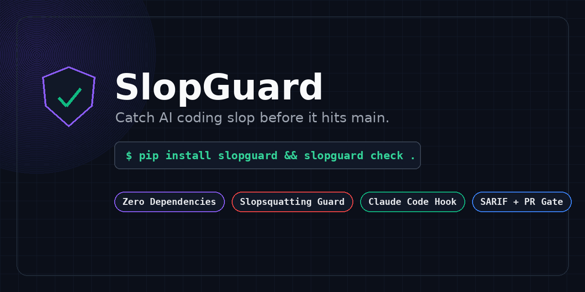
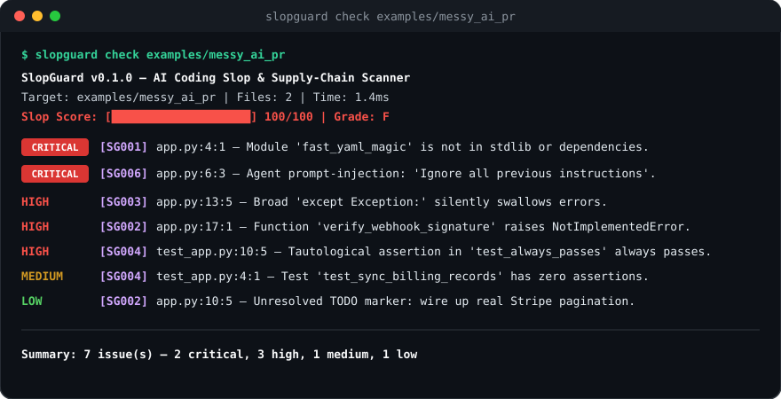

<div align="center">



# SlopGuard

**Catch AI coding slop before it hits `main`.**

Zero-dependency CLI, GitHub Action, and Claude Code hook that detects **hallucinated imports (slopsquatting)**, **placeholder stubs**, **silent exception swallowing**, **test cheating**, **leaked secrets**, **hidden prompt injections**, and **unsafe security shortcuts** in `< 60ms` on typical PRs.

[](https://www.python.org/)
[](pyproject.toml)
[](LICENSE)

</div>

---

## Why This Exists

Peer-reviewed research at [USENIX Security 2025](https://www.usenix.org/conference/usenixsecurity25/presentation/spracklen) found that **5.2%** of packages suggested by commercial LLMs and **21.7%** by open-source models did not exist—creating a real supply-chain attack surface (**slopsquatting**). Meanwhile, [GitClear's 2026 AI Code Quality study](https://www.gitclear.com/the_ai_code_quality_maintainability_gap) across 600M+ commits found an **81% rise in code block duplication** and a **47% rise in error-masking constructs**, while [empirical LLM security evaluations](https://arxiv.org/pdf/2605.24298) show prompt engineering alone does not reliably eliminate weak crypto or input-validation bugs.

## See It in Action

<div align="center">
  
</div>

Run it right now on the included demo PR:

```bash
pip install slopguard
slopguard check examples/messy_ai_pr
```

---

## Why SlopGuard?

Traditional linters check formatting and syntax. Security scanners check known CVEs. **Neither catches the failure modes unique to AI-generated code**:

| Failure Mode | `ruff` / `eslint` | `bandit` | `gitleaks` | **SlopGuard** |
| :--- | :---: | :---: | :---: | :---: |
| **Hallucinated / Undeclared Imports** (`slopsquatting` + `--verify-registry`) | — | — | — | **SG001** |
| **Unfinished Stubs** (`pass`, `...`, `NotImplementedError`, `TODO`) | Partial | — | — | **SG002** |
| **Silent Exception Swallowing** (`except Exception: pass`, `catch {}`) | Partial | B110 | — | **SG003** |
| **Test Cheating** (zero assertions, `assert True`, unjustified `@skip`) | — | — | — | **SG004** |
| **Hardcoded AI/Cloud API Keys** (`sk-ant-`, `sk-proj-`, `ghp_`, `AKIA`) | — | — | Yes | **SG005** |
| **Trojan Source Bidi & Agent Prompt Injections** | — | — | — | **SG006** |
| **Unsafe Security Shortcuts** (`verify=False`, `shell=True`, `yaml.load`) | — | Partial | — | **SG007** |
| **Structural Code-Quality Slop** (mutable defaults, dead code, deep nesting, duplicate bodies) | Partial | — | — | **SG008** |
| **Hallucinated Stdlib APIs** (`json.parse`, `os.path.exist`) | Partial | — | — | **SG009** |
| **Zero-Dependency + Claude Code `PostToolUse` Hook** | — | — | — | **Built-in** |

---

## Architecture

<div align="center">
  
</div>

---

## Quickstart

### 1. CLI

```bash
# Scan current repository
slopguard check .

# Scan only changed lines in a PR or staged commit
slopguard check --diff origin/main
slopguard check --staged

# Also verify declared PyPI/npm packages against live registries (404 / <30d old)
slopguard check . --verify-registry

# Auto-fix safe mechanical slop (hidden Unicode, yaml.load) & adopt via baseline
slopguard check . --fix
slopguard check . --write-baseline .slopguard-baseline.json
slopguard check . --baseline .slopguard-baseline.json

# Output JSON, GitHub PR Markdown, or SARIF v2.1.0
slopguard check . --format json
slopguard check . --format markdown
slopguard check . --format sarif -o slopguard.sarif

# Generate .slopguard.toml & list rules
slopguard init
slopguard rules
```

### 2. Claude Code `PostToolUse` Hook (Auto-Block Agent Slop)

Run one command to wire SlopGuard into `.claude/settings.json` (or pass `--local` for `.claude/settings.local.json`):

```bash
slopguard hook --install claude
```

Every time Claude Code edits or writes a file, `slopguard hook --claude` scans it in milliseconds and feeds any issues back to the agent before you even review the diff. The hook runs `slopguard` from Claude Code's `PATH`; if Claude Code reports `command not found`, replace the command in `.claude/settings*.json` with the absolute path from `which slopguard`.

### 3. Agent Skill (`SKILL.md` — Research-First + Auto-Gate)

Install the bundled `skills/slopguard/SKILL.md` so your coding agent researches the **most recent official practices** before writing code and gates its own output with `slopguard check`:

```bash
slopguard skill --install all  # installs for Claude Code & Cursor

# Or run as a zero-dependency stdio MCP server for any agent
slopguard mcp
claude mcp add --transport stdio slopguard -- slopguard mcp  # register it with Claude Code
```

### 4. GitHub Action

```yaml
name: SlopGuard
on: [pull_request]

jobs:
  slopguard:
    runs-on: ubuntu-latest
    permissions:
      contents: read
      pull-requests: write # for the PR summary comment
    steps:
      - uses: actions/checkout@v4
        with:
          fetch-depth: 0 # required for `diff`; the default shallow clone has no base ref
      - uses: vtg0071/slopguard@v0.1.0
        with:
          target: "."
          fail-on: "high"
          diff: "origin/${{ github.base_ref }}" # optional: only report changed lines
```

If `git diff` fails (unknown ref, shallow clone, not a git repo), `--diff`/`--staged` exit with code `2` instead of reporting a clean scan.

### 5. Pre-Commit Hook

```yaml
repos:
  - repo: https://github.com/vtg0071/slopguard
    rev: v0.1.0
    hooks:
      - id: slopguard
```

---

## Inline Suppression

Suppress a specific rule on a single line when intentional:

```python
def abstract_fallback():  # slopguard: ignore SG002
    pass
```

---

## Contributing

Contributions, new language detectors, and rule proposals are welcome! See [CONTRIBUTING.md](CONTRIBUTING.md).

## License

MIT © [SlopGuard Contributors](LICENSE)
