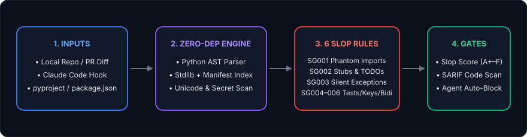

<div align="center">


# SlopGuard

**Catch AI coding slop before it hits `main`.**

Zero-dependency CLI, GitHub Action, and Claude Code hook that detects **hallucinated imports (slopsquatting)**, **placeholder stubs**, **silent exception swallowing**, **test cheating**, **leaked secrets**, and **hidden prompt injections** in `< 60ms` on typical PRs.

[](https://www.python.org/)
[](pyproject.toml)
[](LICENSE)

</div>

---

## See It in Action

<div align="center">
  
</div>

Run it right now on the included demo PR:

```bash
pip install slopguard
slopguard check examples/messy_ai_pr
```

---

## Why SlopGuard?

Traditional linters check formatting and syntax. Security scanners check known CVEs. **Neither catches the failure modes unique to AI-generated code**:

| Failure Mode | `ruff` / `eslint` | `bandit` | `gitleaks` | **SlopGuard** |
| :--- | :---: | :---: | :---: | :---: |
| **Hallucinated / Undeclared Imports** (`slopsquatting`) | — | — | — | **SG001** |
| **Unfinished Stubs** (`pass`, `...`, `NotImplementedError`, `TODO`) | Partial | — | — | **SG002** |
| **Silent Exception Swallowing** (`except Exception: pass`, `catch {}`) | Partial | B110 | — | **SG003** |
| **Test Cheating** (zero assertions, `assert True`) | — | — | — | **SG004** |
| **Hardcoded AI/Cloud API Keys** (`sk-ant-`, `sk-proj-`, `ghp_`, `AKIA`) | — | — | Yes | **SG005** |
| **Trojan Source Bidi & Agent Prompt Injections** | — | — | — | **SG006** |
| **Zero-Dependency + Claude Code `PostToolUse` Hook** | — | — | — | **Built-in** |

---

## Architecture

<div align="center">
  
</div>

---

## Quickstart

### 1. CLI

```bash
# Scan current repository
slopguard check .

# Scan only changed lines in a PR or staged commit
slopguard check --diff origin/main
slopguard check --staged

# Output JSON, GitHub PR Markdown, or SARIF v2.1.0
slopguard check . --format json
slopguard check . --format markdown
slopguard check . --format sarif -o slopguard.sarif

# Generate .slopguard.toml
slopguard init

# List all built-in rules
slopguard rules
```

### 2. Claude Code `PostToolUse` Hook (Auto-Block Agent Slop)

Run one command to wire it into `.claude/settings.json`:

```bash
slopguard hook --install claude
```

Or add it manually to `.claude/settings.json` so **Claude Code automatically runs SlopGuard after every file edit** and fixes hallucinated imports, stubs, or swallowed errors before you even review the diff:

```json
{
  "hooks": {
    "PostToolUse": [
      {
        "matcher": "Edit|Write",
        "hooks": [
          {
            "type": "command",
            "command": "slopguard hook --claude"
          }
        ]
      }
    ]
  }
}
```

### 3. GitHub Action

```yaml
name: SlopGuard
on: [pull_request]

jobs:
  slopguard:
    runs-on: ubuntu-latest
    steps:
      - uses: actions/checkout@v4
      - uses: YOUR_USERNAME/slopguard@v0.1.0
        with:
          target: "."
          fail-on: "high"
```

### 4. Pre-Commit Hook

```yaml
repos:
  - repo: https://github.com/YOUR_USERNAME/slopguard
    rev: v0.1.0
    hooks:
      - id: slopguard
```

---

## Inline Suppression

Suppress a specific rule on a single line when intentional:

```python
def abstract_fallback():  # slopguard: ignore SG002
    pass
```

---

## Contributing

Contributions, new language detectors, and rule proposals are welcome! See [CONTRIBUTING.md](CONTRIBUTING.md).

## License

MIT © [SlopGuard Contributors](LICENSE)
